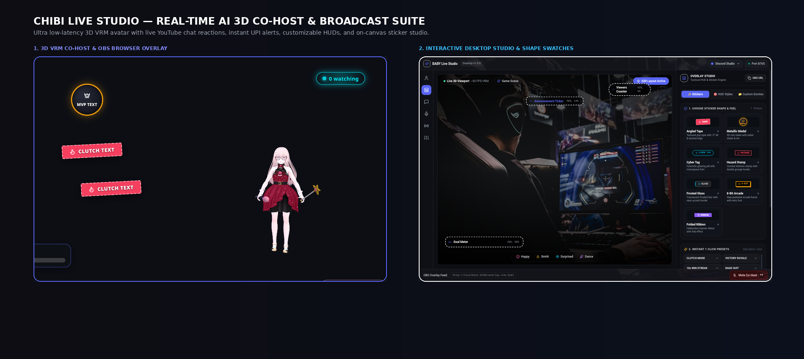
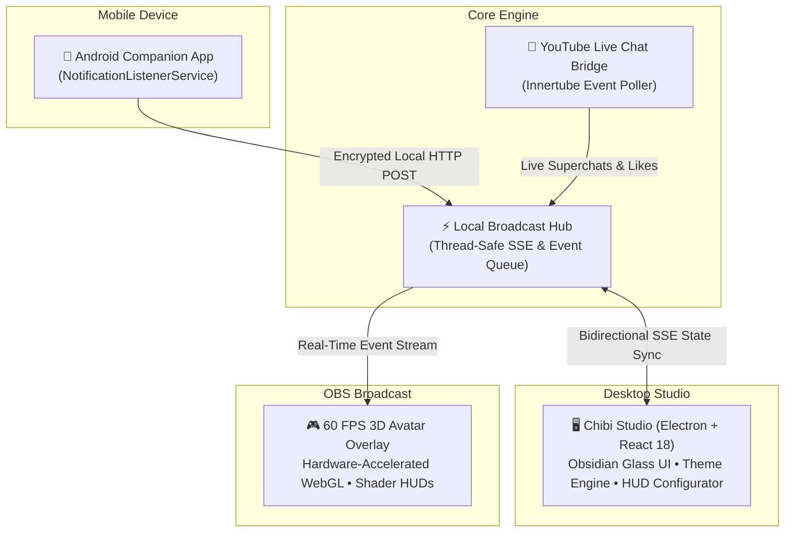

# Chibi — AI Co-Host & Interactive Broadcast Studio

> An intelligent, broadcast-grade VTuber and streaming studio featuring an Obsidian Glassmorphic desktop interface, 60 FPS 3D avatar overlay, and a multi-device event orchestration pipeline.

---

## 📸 Studio Showcase

---

## 🏗️ System Architecture

Chibi connects desktop streaming environments, live chat feeds, mobile payment notifications, and hardware-accelerated 3D avatars into a unified local broadcast pipeline:

---

## 🌟 Key Engineering Highlights

### 1. Multi-Platform Companion Architecture
- **Android Notification Listener Service**: An integrated Android background service that intercepts real-time stream donations and system alerts on mobile devices and relays them to the broadcast server with sub-100ms latency.
- **Zero-Cloud Dependency**: Designed to run entirely on the streamer's local network for absolute privacy and zero subscription fees.

### 2. Obsidian Glassmorphic Studio UI
- Built with **React 18**, **Tailwind CSS**, and **Lucide Icons** within an **Electron** frameless container.
- Real-time bidirectional synchronization: External API pushes update the studio inspector and visual meters simultaneously without UI jitter.

### 3. 60 FPS 3D Avatar & Broadcast HUD Overlay
- Hardware-accelerated 3D avatar rendering with real-time expression and pose reaction pipelines.
- Modular broadcast HUD with dynamic theme palettes (Cyber, Neon, Retro, Obsidian Glass).

## 🔒 Proprietary Architecture Notice

This public repository serves as an architectural portfolio and design system showcase for technical demonstration. The core broadcast daemon, Android companion APK, proprietary 3D avatar meshes, and real-time polling services are closed-source.
